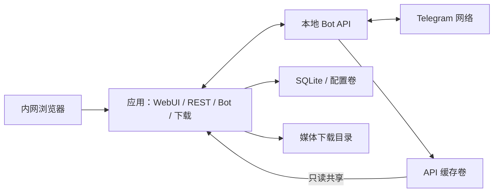

# Telegram 媒体下载助手：技术设计

## README部署入口与站点导航（2026-10-22）

根README快速部署沿用准备、构建、初始化三段，详细参数直接链接deployment.html对应章节。所有README文档导航使用站点绝对URL；项目贡献/安全/许可/构建来源由project页面可定位章节承接并保留权威原始文件链接，配置文件与GitHub操作仍属源码入口。检查将站点URL映射到本地dist并解码锚点，避免仅相对链接检查漏过失效站点路径。

## Docker部署文档结构（2026-10-22）

部署页采用准备材料、最小启动、逐项配置参考、后续本地API/网络/维护的阅读顺序。以真实Dockerfile/COPY和compose依赖核对必留目录；将文档中的注释版配置与真实文件解析结果比较，不能仅凭肉眼声称完整。生产配置保持原样，相关入门链接同步，恢复和数据权限边界保留。

## 切换可恢复性设计（2026-10-22）

- 前端请求必须有时间边界并在finally释放本地busy；共享状态刷新失败保留旧数据且标为过期。重新同步只读运行状态，不重新加载表单，不自动重发保存，不以本地计时强行解除后端busy。
- 后端将连接请求及屏障等待按阶段限制；真实下载owner排空不设粗暴截止，正常Telegram cooldown按持久deadline继续。失败可修正/重试，旧请求仍持锁时不得启动另一套连接。
- 云端退出超时属于结果不确定，持久logout_uncertain，不自动重放。恢复仍保留请求保护、下载所有权及管理命令幂等边界；重启应用不等于确认云端退出。
- 实现后以定向故障注入验证超时、重新同步、重试及重启，独立审查后再更新本地app；不清业务数据或上游保护。

## 连续连接操作保护增量（2026-10-22）

- 复用持久连接状态机与配置修订，引入内部cloud_reconnect动作覆盖云端有效代理变化，不增加防抖队列。draining表示排空下载owner及已有poll/notify请求，随后只释放/重建应用云端客户端；禁止调用cloud logOut或本地supervisor命令。
- 忙碌期间后端拒绝连接变化；无关配置可保存但不能改变操作快照。disabled proxy的有效签名仅含enabled:false，避免未生效字段触发连接变化。identity完成后重新核对当前签名/操作状态，过时结果关闭并丢弃，不发布旧用户名或online。
- 云端重连保护适用于标准部署和无受管本地服务的云端部署；后者不能因此获得本地服务管理权限。失败后的原配置重试仍可达。
- 前端以真实运行状态及保存后握手锁连接字段，保留表单输入和dirty/版本语义；错误或暂停阶段仍显示实际原因并允许合适恢复，不锁死普通配置。

## 当前体验与版本设计（已确认，2026-10-22）

- Shell以一个经认证的共享状态轮询源驱动顶部摘要和设置状态；复用现有usePolling的取消、过期响应、保留上次数据及后台策略。退出登录销毁轮询和会话调试开关。不得因状态刷新重新赋值设置表单；PATCH后的旧修订响应不得回退生效状态。
- 系统页移除后迁移用户动作到设置对应分区，复用LocalApiPanel/BotSafetyPanel/DiagnosticLogPanel并清理旧页面及引用。只保留当前导航，无未发布旧页面兼容层；顶部异常能定位相关设置并遵守未保存保护。
- 设置分区保留一份响应式表单，切换/展开不重建值、不改变dirty语义；使用单一可预测滚动区域和实底操作栏。当前模板预览、离线保存/手动校验、备份恢复及互斥busy状态保持。开发者模式仅改变可见细节，绝不是后端授权或运行配置。
- 顶部摘要按风险优先，旧数据明确标为状态未更新，避免误报已连接；移动端压缩摘要并提供可访问详情，不把完整诊断卡塞入顶栏。无需新增状态后端接口。
- 版本采用仓库权威元数据及同步校验；后端API/OpenAPI、WebUI关于信息、前后端包及镜像构建标签和文档统一0.1.0。Python包遵循其合法数字版本格式；独立文档依赖及第三方依赖版本不参与批量替换。构建产物保留元数据，不依赖运行目录或Git可用。
- 版本更新日志保留根CHANGELOG，文档站展示同源内容，避免两份手工日志漂移；明确开发阶段，记录日期是真实本次记录日期，不虚构正式发布。普通用户优先看影响与操作变化，编译和验收细节留开发文档。
- 本增量无数据库迁移；不清理现有业务或媒体。源码改版不直接改运行容器；后续部署继续停服备份/无活动获取/保护状态保留要求。

版本：v0.1，2026-10-20。状态：已确认并实施本地版本；真实 Bot/NAS 尚未验证。云端 / 本地切换补充见第 13 节，实际实现差异和验证结果见 implement.md 及 docs/verification.md。

依据：[需求文档](../../../docs/project-requirements.md)；[技术证据](research/technical-evidence.md)。产品行为以需求文档为准，本文件定义实现契约。

## 1. 技术选择

### 2026-10-21 superseding deployment/log design

This first release uses one Compose topology: app, managed official API, and a
network supervisor sharing the API network namespace. A bounded one-shot init
prepares independent private named control volumes; no Docker socket or full app
data access is granted to supervisors. Direct operation is an explicit acknowledged
network command, and enabling a proxy uses default-deny until the selected proxy
is applied. Failure cannot silently reuse direct routing. Network heartbeat,
revision acknowledgement, migration snapshots and durable ownership barriers must
agree before target API activation. The host must support Linux containers and
TUN; actual fnOS and bundled proxy acceptance remain separate gates.

Diagnostic settings add `diagnostic_log_cleanup_time` (`HH:MM`, default `08:00`),
using the configured application timezone. Startup and policy changes schedule
the next future local occurrence without an immediate age scan. A once-per-minute
lightweight timer executes a single due cleanup, then schedules the next future
occurrence; no catch-up bursts. Retention zero disables age scans; capacity
rotation stays enabled. Manual clearing does not move the daily deadline.
`DiagnosticLogStatus` additionally returns `cleanup_time`, `timezone`,
`total_bytes`, and `file_count`; usage is a bounded stat of fixed active/archive
files, never a content scan or arbitrary directory traversal.

No compatibility promise applies to pre-release implementations. Remove affected
obsolete deployment paths rather than retain two workflows; preserve actual test
data, credential privacy, ownership, cooldown and uncertain logout state. Future
formal releases will define migration/version compatibility separately.

| 部分 | 方案 | 取舍 |
| --- | --- | --- |
| 后端 | Python 3.12、uv、FastAPI、Pydantic 2 | 异步 Telegram 处理和统一管理接口。 |
| Bot | aiogram 3，云端 / 本地 API 可切换 | 长轮询；云端 HTTPS 文件流，本地共享缓存，不引入个人账号。 |
| 数据 | SQLAlchemy 2、Alembic、SQLite WAL | 单实例降低运维负担，数据库放可靠本地文件系统。 |
| 调度 | 持久化队列、应用内有限异步 worker | 无 Redis/Celery，必须实现领取、幂等、恢复。 |
| WebUI | Vue 3、TypeScript、Vite、Element Plus | 中文、手机可用，静态产物由后端服务。 |
| 更新 | 活动页 3 秒轮询，后台降频 | 首版无需 WebSocket。 |
| 本地 API | 官方 Telegram Bot API，固定 revision 构建 | 不依赖第三方镜像的隐含参数。 |
| 可选代理 | sing-box TUN 网络组件 | 将本地 API 的真实 Telegram 流量送往 HTTP CONNECT/SOCKS5 代理。 |

精确补丁版本和镜像 digest 在脚手架时解析并锁定，不编造未验证的版本组合。应用仅运行一个 Uvicorn worker，数据库目录实例锁防止重复消费者。同步数据库事务和大文件 I/O 在线程池执行，不阻塞事件循环；事务保持短小，文件复制不持有数据库锁，会话不跨线程共享。

范围不增加链接抓取、媒体播放/文件删除、频道监听、多 Bot、群聊或多租户；后续允许移除已结束任务记录。保持一个端到端任务，内部按顺序里程碑交付，暂不创建可独立发布的子项目。

## 2. 拓扑和部署

直连使用双服务 `compose.yaml`；代理使用独立完整的三服务 `compose.proxy.yaml`，避免依赖飞牛 OS 未必支持的 Compose merge/reset 扩展。



代理模式的 Bot API 与 `telegram-network` 共享网络命名空间，出站经过 TUN；应用 API 地址为 `http://telegram-network:8081`，直连为 `http://bot-api:8081`。内网 API/WebUI 不走外部代理。

| 路径 | 挂载和责任 |
| --- | --- |
| `/data` | 应用可写：数据库、配置、密钥、实例锁，与媒体分开。 |
| `/downloads` | 飞牛 OS 下载目标，可写；额外允许根由部署显式配置。 |
| `/var/lib/telegram-bot-api` | API 可写、应用同路径只读共享；应用不删除其内部文件。 |
| `/run/tgd-network` | 仅代理模式，受控配置与应用结果交接，不通过 Web 暴露原始内容。 |

应用和 API 配置 UID/GID；无代理时无需 TUN 或额外网络权限。网络容器仅需 `NET_ADMIN` 和 `/dev/net/tun`，不使用全特权模式。应用不挂 Docker socket，不编辑宿主机防火墙。设备架构、TUN 和文件系统能力未实测前不标记兼容。

WebUI 容器内监听 `0.0.0.0:8000`，宿主机端口/内网绑定可配置；只发布 WebUI，8081 留在内部网络。不要求公网域名。存储或 Telegram 不可用时保留 WebUI 诊断，暂停相应调度。

## 3. 目录和模块

```text
backend/
  app/
    main.py       生命周期、路由、静态资源
    core/         配置、鉴权、时间、脱敏、实例锁
    db/           模型、会话
    schemas/      DTO、错误和状态枚举
    api/          管理 API
    bot/          Telegram 消息与回调适配
    services/     确认、去重、配置、统一任务投影
    workers/      调度、执行、恢复、通知
    storage/      根目录、命名、空间、原子发布
  migrations/
  tests/
frontend/src/{api,views,components,router,stores}/
deploy/           镜像构建与入口、网络 supervisor
docs/             部署、升级、接口、验证记录
```

Bot/REST 共同调用 services，不各建一套队列。storage 不依赖 Telegram，worker 不负责 UI 文案。后端 schemas 拥有状态、错误码和 DTO，前端从 OpenAPI 生成类型。未填充的 Trellis spec 不是已有架构；脚手架形成后再用真实代码补充对应规范。

## 4. 数据模型

ID 使用不可预测应用标识，Telegram ID 为 64 位整数；UTC 入库，RFC 3339 输出。SQLite 开启外键、WAL、busy timeout，迁移单实例执行。

| 表 | 字段和约束 |
| --- | --- |
| `settings` | 单例、schema_version、revision、值；敏感值受控加密。 |
| `admins` / `sessions` | 唯一管理员、Argon2id 散列；会话 token 散列、到期和 CSRF 绑定。 |
| `bot_identities` | Bot Telegram ID、配置版本、启用状态；Token 不作公开 ID。 |
| `ingest_updates` / `poll_cursor` | 唯一 `(bot_id, update_id)`，持久化 inbox；每 Bot 下一 offset。 |
| `requests` | single/group、用户/chat、分组键/批次、聚合截止、卡片 ID、nonce、expires_at、状态、确认配置快照、revision。 |
| `media_items` | 顺序、message_id、file_id、file_unique_id、类型、原名、可空大小/时长；消息关联唯一。 |
| `jobs` | 每项一任务、状态/阶段、进度、固定根/相对路径、尝试序列、重试上限、next_run_at、取消意图、boot_id、revision。 |
| `attempts` | 唯一 `(job_id, sequence)`、时间、错误码和脱敏原因。 |
| `file_reservations` | 唯一 `(bot_id, file_unique_id)`，指向活动任务，跨请求互斥。 |
| `stored_files` | Bot/文件唯一标识、根 ID、相对路径、字节数、流式 SHA-256、保存时间。 |
| `publish_journal` | 每 job 唯一：临时/最终相对路径、发布阶段、字节/散列。 |
| `notification_outbox` | 唯一事件键、请求/任务、payload、状态、次数、下次重试、已知 Telegram message_id。 |

确认、领取、文件占用、结果与通知出箱使用短事务。通知键包含结果版本，允许手动重试后产生新终结结果。原始源路径仅内部使用，不进 DTO/日志。已存在媒体关联原任务/文件，不伪造新下载记录。

## 5. 接收、分组和确认

### 5.1 持久化接收

显式管理长轮询 offset：先把整批 updates 与下一 offset 同事务落库，再幂等处理。不能依赖框架默认调度中提前推进的 offset。崩溃后重放 inbox，重复由唯一键过滤。仅授权私聊消息创建请求，限制不必要 update 类型。

处理原生 video/photo 及受支持 document，照片选最大尺寸；缺失元数据为 null。链接即使显示预览也不发起获取。

### 5.2 媒体组

分组键 `(bot_id, chat_id, media_group_id)`；无组标识独立创建请求，不按消息相邻推测同组。初始聚合常量为最后到达后 1 秒静默、最长 5 秒窗口，持久化截止时间；实测可调整，不改变确认有效期。

冻结成员后发送一张卡片；成功取得 message_id 时计算默认 30 分钟到期。内部保留秒数，界面以分钟编辑。发送结果不确定时使用保守原创建期限恢复，重复卡片共用 nonce，不能无限延长。冻结后迟到项开新批次，提示后续文件并再次确认。组内逐项执行，混合媒体不拆目录。

### 5.3 幂等确认

回调只带短请求 ID、随机 nonce 和动作，满足 callback 长度限制。校验操作者/chat、白名单、nonce、服务器 expires_at、配置修订；条件更新 `awaiting_confirmation -> queued`，同事务创建文件任务和入队通知。重复点击只返回现态。

下载目标/Bot 身份变动影响卡片时原卡失效，重新展示并请求确认；修改确认时限不改变旧卡到期。取消/过期 nonce 不可复活。

## 6. 调度、去重和状态

按 next_run_at/创建时间领取，条件更新和 boot_id 标记。全局 fetching+saving 默认最多 3 个文件任务，媒体组不额外分配槽，组间公平领取。并发不是单文件多连接分段下载。

```text
queued -> fetching -> saving -> succeeded
              |          |
              +-----> retry_wait -> queued
              +-----> failed
queued/retry_wait -> cancelled
fetching/saving -> cancelling -> cancelled 或实际已完成的 succeeded
```

父请求状态由服务投影：仍有活动项显示活动阶段；终结后全可用（下载成功/已存在）为成功，部分可用且有失败/取消为 partial_success，全失败为 failed，全取消为 cancelled。纯去重显示“已保存”，不误报新下载；客户端不自行推断汇总。

领取前核对 stored_files 的实际文件存在性，失效文件允许重下。插入唯一 reservation；冲突关联已有任务，成功后验证并显示已有路径，失败后再竞争。瞬时重试保留占用，确定失败/取消后释放，启动修复遗留占用。组内去重不移动/复制旧文件，新下载项仍写同组目录。异常缺失 unique ID 不用文件名冒充，不进行依赖该 ID 的全局去重。

本地 getFile 用独立、足够长且可配置的获取超时；此阶段只显示阶段/时间。返回源路径必须 realpath 后位于共享 API 根下且是普通文件，防止 symlink 越界，然后流式复制到目标临时文件。保存阶段展示真实字节/速度，不造百分比。

取消在复制块边界检查并清理本应用临时文件；底层获取未终止时保持 cancelling，并保留槽直到请求结束或确定终止。不能超时断开客户端后立即释放槽，从而放大 API 实际并发。

自动重试默认 3 次（首次执行之外），指数退避带抖动、持久化 next_run_at；限流至少等待 retry_after。空间/权限/无效凭据错误不自动反复重试。手动重试生成新的尝试序列，保留历史和目标，只重试失败项。

## 7. 路径、发布和恢复

### 7.1 归档契约

- 单文件：`YYYY-MM-DD/<名称>`，图片与视频直接放在日期目录。
- 媒体组：`YYYY-MM-DD/<消息文字摘要或回退名_组短ID>/<名称>`，图片/视频同目录，不再增加 videos/images/groups 分类层。
- 日期使用请求创建时间及归档时区；仅新冻结目录采用按日规则，已有目录、已保存文件和重试路径不迁移。
- 任务名优先截取媒体消息附带文字；组按消息顺序选首个有效文字，缺失则回退原文件名或媒体描述。新任务名不自动追加编号，持久化冻结后由 Bot 及 WebUI 共用；列表二级信息显示完整编号，Bot 确认/入队/结果和状态逐项使用系统独立编号行（在用户模板外追加并预留 UTF-16 长度预算）。目录名保留防重短标识并另行安全清洗和限长，文件名继续使用现有模板，旧冻结任务不改写。
- 确认时按部署时区固定根/目标；无原名自动生成，冲突加稳定项 ID，不覆盖。重试沿用组目录。
- 设置接口用 root_id，不接受任意宿主机路径。清洗分隔符、控制符、保留名、`..` 和编码后长度。
- 源和目标均验证实际路径、symlink；尽可能用目录句柄和 no-follow，不能只做字符串前缀校验。
- 初始化写根目录随机标记，执行前检查标记和挂载身份；远程挂载掉线后留下的空目录不得自动重建为新存储。结合实际写入/挂载检查，错误时不改用其他目录。

### 7.2 发布协议

1. 在最终文件同一文件系统创建独占 `.part.<job_id>`，登记 journal。
2. 流式复制并计算 SHA-256，比对已知大小，完成 flush/fsync。
3. 持久化 ready_to_publish journal：最终路径、字节与散列。
4. 与取消互斥，检查取消意图，再原子“不覆盖发布”，同步目录。
5. 同事务登记 stored_file/成功/通知出箱，清理 journal 和自己的临时文件。

Linux 优先 `renameat2(RENAME_NOREPLACE)`，支持时可采用同盘原子硬链接发布；禁止用可能覆盖的 replace 静默替代。文件系统不支持时先报能力诊断，外部碰撞则选择新后缀并更新 journal。散列用于恢复验证，不做全盘内容去重扫描。

| 崩溃后事实 | 恢复行为 |
| --- | --- |
| 只有未完成 .part | 清理自己的半成品并重排，不声称断点续传。 |
| ready_to_publish、仅临时文件完整 | 校验后发布；有取消意图则清理。 |
| 最终文件存在、DB 未成功 | 按 journal 大小/散列核对，补记成功，冲突文件不覆盖。 |
| DB 成功、媒体不在 | 保留历史执行，使存储索引失效，显示不可用且允许重下。 |
| 旧 boot_id 的获取任务 | 检查本地 API 是否仍后台获取，确认终止/协调重启或等待后再恢复槽。 |
| 仅通知未发送 | 恢复通知，不重下载。 |

磁盘/数据库不能一起提交，必须有 journal。应用崩溃不等于 API 获取终止，其确认/恢复机制列为首批原型。空间预算考虑 API 缓存+目标双份和并发，同盘/跨盘分别处理，未知大小仍留最低余量并捕获 ENOSPC。

API 缓存只能用已验证的上游支持方式维护；没有安全在线清理能力时提供容量告警、停服维护流程，应用不直接 unlink 上游内部文件或索引。

## 8. 代理的真实生效

官方 --proxy 仅用于 webhook。保持官方 C++ 不打补丁，用可选网络组件承载实际 Telegram 代理；TUN 权限/路由须在飞牛 OS 验证。

- 上游支持 HTTP CONNECT/SOCKS5、地址/端口、可选认证，默认 disabled；普通 HTTP 转发代理不等于 CONNECT。
- WebUI 保存 desired revision 到受控卷，网络 supervisor 严格校验 schema，生成配置并检查，再应用、写回 applied revision/脱敏结果。应用不执行任意 shell，不控制 Docker。
- 状态 `disabled/pending/applying/active/failed/restart_required`；只有网络验证通过才 active，不把保存成功当生效。
- 更新时暂停新任务，等当前任务安全停止/完成再变更，失败保留旧配置并明确提示；不得静默直连回退。
- 从双容器改为代理方案需用户按部署指南重建，界面可存配置但显示 restart_required；已有网络组件时 supervisor 仅重载自身子进程。若 API 长连接要求重启也明确提示，不能伪称热生效。
- TUN 路由只处理 API 出站，排除代理地址与必需内部子网，设计 DNS、防循环、代理故障和 supervisor 退出时禁止直连的策略。HTTP CONNECT 不依赖 UDP 转发能力。
- 容器 localhost 不等于宿主机；同机代理使用可达网关/host-gateway，文档说明。连通探测目标固定，不能成为任意 URL 请求器。

## 9. 配置、认证和密钥

| 配置 | 默认/生效 |
| --- | --- |
| confirmation_timeout_seconds | 1800（30 分钟）；正整数秒，界面分钟，新发卡片生效，旧值及旧卡到期不变。 |
| download_concurrency | 3；正整数，后续领取，降低不强杀现有文件任务。 |
| max_auto_retries | 3；非负整数，新任务/手动重试序列快照。 |
| allowed_user_ids | 至少一个；新输入/操作即时校验，已授权任务不静默取消。 |
| download_root_id | 部署允许列表；新确认任务生效。 |
| timezone | 默认 Asia/Shanghai，可配置；新归档路径使用，数据库始终 UTC。 |
| bot_token | 无默认、write-only；getMe 校验，有活动/待确认请求时禁止更换 Bot 身份。 |
| proxy | 按上一节 handshake 生效，非普通配置原子热改。 |

优先级：显式环境变量 > 数据库 > 默认值。返回 value/source/editable，覆盖字段只读。PATCH 带 revision，冲突 409；先校验再提交，外部生效结果单列 pending/failed。API ID/Hash、端口、挂载、UID/GID、代理能力模式由部署控制，WebUI 不编辑宿主机配置。

首次无通用密码：生成一次性 bootstrap secret，存权限受限 `/data/bootstrap.key`，部署者从本地读取后初始化唯一管理员并使其失效。不能允许任意内网用户抢先初始化。密码 Argon2id；服务端会话只存 token 散列，Cookie HttpOnly/SameSite、会话过期/退出/改密失效、登录限速。写请求校验 CSRF 和 Origin，默认不开放 CORS。HTTP 内网 Cookie 不强制 Secure；HTTPS 反代模式开启，避免 HTTP 下无法登录。

Bot Token/代理认证加密存储，主密钥在独立权限受限文件或部署 secret，备份须包含密钥；不声称能防御已控制宿主机者。读取返回 configured/掩码，空值不改、clear 显式清除。HTTP 客户端/错误/日志必须遮蔽 URL 路径中的 Bot Token。

## 10. REST 和页面

前缀 `/api/v1`；时间 RFC 3339，错误 `{error:{code,message,request_id,details}}`，无堆栈/密钥；列表 `{items,total,page,page_size}`。枚举英文、前端中文映射。

| 接口 | 合约 |
| --- | --- |
| GET /setup/status、POST /setup | 仅 initialized 对外可读；一次性 bootstrap 初始化。 |
| POST /auth/login、POST /auth/logout、GET /auth/me | 会话和 CSRF。 |
| GET /tasks | 按请求/组展示，筛状态/名称，分页倒序。 |
| GET /tasks/{id} | 文件项、尝试、相对路径、已有文件引用、通知。 |
| POST /tasks/{id}/cancel | 幂等，终态返回真实结果或冲突。 |
| POST /tasks/{id}/retry | 失败项新序列，事务防重复，可选失败子项。 |
| GET /settings、PATCH /settings | 脱敏值、来源、revision、生效状态。 |
| POST /settings/validate | 不保存/激活消费者，不切换云端实例。 |
| GET /system/status | 鉴权诊断：Bot、空间、根、代理、最近错误。 |
| GET /health/live、GET /health/ready | 极简探针；未就绪 503，无内部诊断泄漏。 |

除 setup/login/极简 health 外均鉴权，写操作校验 CSRF。无 Web 确认、媒体流、任意文件读写/删除接口。

进度 DTO：phase、completed_bytes、可空 total_bytes/speed_bps、elapsed_seconds；分母未知不显示百分比。详情提供 effective_destination/items/attempts/notification_status，不返回宿主机绝对路径。页面为初始化/登录、任务、详情、设置、系统；组内展示成功/失败/已存在，设置区分保存与应用。轮询取消旧请求或按版本防慢响应覆盖新结果。移动端用卡片/清晰操作，状态用文字加颜色。

## 11. 通知、运维和回滚

结果与出箱同事务，通知 worker 独立有限重试/限流；结果不确定可能重复通知，但不重下载。优先编辑已知卡片，永久发送错误单独报告。日志带任务/尝试/阶段，不含完整 file_id、Token、源绝对路径或原配置，Compose 轮转。

备份先停领取、等待发布，SQLite 一致性备份或停服复制，含主密钥与映射；媒体另备份。升级前备份、单实例迁移；失败不启动消费者，保留诊断。回滚恢复匹配旧镜像的数据库/密钥，不承诺任意 downgrade。停止给有限退出时间，超时靠启动核对恢复。

云端转本地按官方 logOut 流程一次性迁移，不启动时反复自动 logOut，不默认丢 pending updates。网络容器重建涉及共享 namespace，指南明确一起重建 API，不只换容器名。

## 12. 验证边界

无阻塞产品决策，技术门槛为 research 中 V-01～V-08。大文件、混合媒体组、飞牛 OS 权限/原子发布、代理认证/DNS/禁止直连回退、取消/崩溃后的后台获取、缓存维护、目标架构都未实测。

真实验证在部署环境配置凭据，不在聊天索取密钥。无设备时先完成假服务和 Linux 集成测试；验收记录必须分开“模拟通过”和“真实设备未测”。失败应修复方案，不能默默删除已确认能力。具体执行顺序见 [implement.md](implement.md)。

## 13. 云端 / 本地切换补充设计

同一设置页持久化 `bot_api_mode=cloud|local`。新建数据库默认云端，已有配置缺少此字段时保持本地，避免升级后意外改变获取链路。云端只需 Bot Token 和允许用户 ID，不需要 API ID/Hash；本地模式继续使用部署配置中的 API 地址、共享缓存和应用凭据。主 Compose 默认仅启动应用，`local-api` profile 供部署者准备本地组件；WebUI 切换不会创建容器或自动执行 `logOut`。

配置保存与在线校验继续分离。模式变更须与任务领取在数据库事务中互斥，有正在获取、保存、取消或等待恢复的任务时拒绝切换；排队任务可在切换后使用新模式。任务领取持久化 `Job.acquisition_mode`，重启恢复按任务自己的获取模式判断，不跟随全局设置改变。运行连接签名包含模式及代理，不把旧连接的结果套用到新配置上。Bot 身份与通知归属保护继续生效。

云端确认后通过官方 HTTPS 接口获取文件，按已知元信息、响应长度及实际累计字节检查 20 MB 上限；未知长度不能绕过限制。文件仍进入 part、散列、fsync 和原子发布链路。云端连接关闭后可安全清理本地未完成流；本地 API 的不确定后台获取继续依赖 generation 核对，不能混用两种恢复语义。HTTP CONNECT/SOCKS5 代理覆盖云端 API 和文件流，不依赖 TUN，代理失败不直连回退。

云端是暂时无应用凭据时的使用入口，不替代本地模式大于 20 MB 的首版需求及真实验收。

## 14. 确认提示与文件命名模板

在现有设置契约新增 `confirmation_template` 和 `filename_template`，使用纯文本和白名单 `{变量}`，不开放表达式、属性访问或代码执行。前者默认保留确认标题、目录、有效期、文件清单；后者默认 `{name}_{id}`，自动附加原扩展名或媒体类型默认扩展名。文件模板只控制文件名，不控制归档目录；保存仍经过路径清理、长度约束、同名冲突和非覆盖发布保护。

确认提示变量：`title`、`file_count`、`total_size`、`files`、`destination`、`expires_in_minutes`（分钟）及兼容旧模板的 `expires_in`（秒）。文件名变量：`name`（原名不含扩展）、`date`（YYYYMMDD）、`time`（HHMMSS）、`datetime`（YYYYMMDD_HHMMSS）、`type`、`index`（按消息顺序从 1 开始）、`id`（媒体短 ID）。时间采用请求创建时间与设置时区；未知文件大小显示未知。前端示例预览明确为演示，不操作真实 Bot。

新确认卡冻结每项计划文件名并在确认后写入 Job，后续模板/时区设置不更改已有卡或任务。迁移保留旧卡兼容处理，已成功文件和重试路径不变。模板空白、未知变量、错误括号与文件名路径分隔符/控制字符在本地校验拒绝，保存仍无需 Telegram 在线验证。

## 15. 任务记录删除与简洁反馈（后续增补）

任务采用可空 deleted_at 软删除，保留下载文件、StoredFile 去重和恢复关系。仅终态请求且没有活动 Job 可删除；事务内检查并标记，请求列表/详情/取消/重试及 Bot 操作排除已删除记录。批量删除整批原子执行，当前页选择，遇到活动或不存在项不部分提交。已删除项的未发任务通知停止派发，保留必要历史。新接口：DELETE /api/v1/tasks/{id} 与 POST /api/v1/tasks/delete（ids: 1..100 个去重任务 ID）；成功返回 deleted_ids。任务 DTO 增加 can_delete。认证、同源与 CSRF 和其他变更接口一致。文件删除继续不在范围内。

任务页保留筛选、搜索、状态、进度和必要错误，移除冗余引导。行选择与详情/单条操作分别可键盘触达，轮询不重置当前选择，分页/筛选清空选择，删除后纠正空末页。设置保留实心普通布局操作栏，保存/校验反馈使用短暂 ElMessage，不再为反馈常驻占高；版本冲突仍保留输入、禁用冲突保存并可重新读取。

## 16. WebUI 管理本地 API（用户已批准）

新标准部署常驻 API supervisor（无凭据时等待，不退出容器），app 通过独立私有控制卷传递版本化 desired/applied 文件。专用加密密钥仅用于 API Hash 交接，不共享 app master.key 或数据库。supervisor 仅管理固定官方 API 子进程，更新缓存 generation 和状态心跳；无需 Docker socket 或任意命令执行。旧外部 API 部署通过 managed_local_api=false 保持兼容。默认和 TUN 拓扑均可管理进程，拓扑切换仍属部署操作。

设置新增 telegram_api_id、加密且不回传的 telegram_api_hash；空值保留和显式清除语义与 Bot Token 一致。已有部署环境凭据作为可覆盖 fallback。模式为期望状态，独立持久运行状态记录已应用模式、操作及阶段、云端冷却和退出不确定性；不能把保存成功当作已切换。无凭据或控制组件失联不影响 WebUI 启动。

保存模式或已应用凭据发生变化时创建幂等操作：阻止新任务领取、暂停并等待轮询/通知请求退出，下载拥有者排空后执行官方切换。领取与操作屏障在同一事务核对，避免检查后出现新下载。退出云端前持久记录阶段；结果不明确或中途崩溃时进入受阻状态，不重复退出或自动回云。成功后本地可立即启动并验证身份，回云必须先等持久冷却期限。手动重启 API 同样排空拥有者，确需解决 recovery_blocked 时只有旧 API 已终止和 generation 变化才释放不确定槽。候选在线校验遵守同样模式/冷却屏障，不能旁路启动另一端。

状态 API 分开报告 API 进程、已应用模式、Bot 连接与操作阶段，心跳过期视为失联；设置和系统页轮询状态但不覆盖未保存输入。手动重启和重试为认证/CSRF 保护的异步操作，重复点击不并发执行，不暴露 Hash/Token/原始异常。测试覆盖无凭据等待、子进程真实启停（假二进制）、凭据脱敏、冷却/未知退出/重启恢复、并发领取/轮询和手机显示；真实 Telegram 大文件及 fnOS 仍需实机验收。

## 17. Telegram 请求保护

应用使用独立的持久请求保护服务，注入所有正式、在线校验及迁移用 TelegramClient；云端文件 HTTP 请求也必须遵守保护，文件字节块不逐块节流。状态按凭据摘要隔离，不保存 Token 或原始上游错误；变更模式/代理、创建客户端或重启应用不得清除同一凭据的等待。短事务预留请求起始时隙，事务和互斥锁不跨网络调用/长轮询/流式传输。默认应用级请求间隔 1 秒、同私聊发消息 1.1 秒、群聊 3.1 秒，为保守应用策略而非官方安全阈值。

任一入口收到 429/retry_after 时，取最长持久冷却，阻止该 Bot 的其他新请求；成功请求不得缩短已有服务器冷却。认证 401 暂停该凭据的自动请求，单个聊天的 403 不暂停整个 Bot。网络失败采用有上限的指数退避。长等待快速返回可识别的暂缓结果，不能阻塞配置保存、迁移排空或持续消耗任务/通知重试次数。保持 active getFile 所有权及冻结归档，暂停不等于上游取消。

系统状态的 bot.request_safety：state 为 ready/throttled/backoff/auth_paused，retry_at 为可空 ISO 时间，message 为安全中文，can_retry 表示可手动恢复。状态读取只观察，不探测 Telegram。POST /api/v1/system/bot/retry 仅针对已保存配置、需要认证和 CSRF；手动探测至少间隔 60 秒，不跳过服务器冷却或本地迁移屏障，不执行 logout。仅成功验证可解除认证暂停，离线保存继续独立。

迁移退出云端前先核对请求保护；明确未发出的本地暂缓不能标为退出结果未知。真实 logout 已发出而结果不明时，继续保持原有不确定退出保护，不能由恢复按钮重放。WebUI 系统卡片及本地 API 状态显示请求等待/暂停与预计恢复时间，已有操作结果保持短暂提示；不引入关闭保护的配置开关。

## 18. 持久诊断日志

默认在 data_dir/logs/events.jsonl 写结构化事件，UTC ISO 时间含时区；单文件 10 MiB、保留 3 个归档，随 /data 持久卷跨容器重建保留。事件仅白名单字段：固定事件/方法/结果分类、云端或本地模式、HTTP/应用错误码、耗时、等待期限及内部任务/请求编号；不写入 Token/Hash/密码、URL、原始异常或堆栈、媒体文字/文件路径、Telegram 用户和聊天资料。正常空长轮询不逐条写，重复失败或等待合并，保留首发与恢复/摘要。日志失败不改变下载及迁移结果，但须在诊断状态中可见；写入/轮转线程安全，不在数据库事务内执行日志 I/O。日志组件不获取业务网络锁，异步调用通过线程执行并等待短文件 I/O 返回，以优先保留首次异常；已有调用者的连接/轮询/通知锁可能在等待落盘期间继续持有，慢日志卷可延长调用与排空时间，不声称完全非阻塞，也不引入后台无限队列。

系统页提供诊断日志状态和导出按钮，无自动下载/上传；GET /api/v1/system/logs 需管理员认证，返回有界的最新日志事件 JSON 数组与截断信息，按固定字段再次投影，不允许用户指定任意路径。前端由响应生成 JSONL 下载，使用现有会话失效处理。系统状态含日志可用/失败与保留说明。写入失败、恶意异常、并发轮转、跨服务关联、认证及导出边界须有自动测试；使用模拟 Telegram 和临时目录，不操作用户服务或密钥。

## 19. 日志保留与清理

UserSettings/SettingsPatch 新增 diagnostic_log_retention_days，默认 7，允许整数 0–3650，0 关闭按天清理但不关闭容量轮转；持久化与 revision 冲突处理沿用现有设置，修改不触发 Telegram 校验、重连或 API 切换。启动及后台周期维护即使无 Bot、空闲或请求暂停也能执行，最长一小时内按新配置清理；按事件 UTC 时间去除过期记录，保留边界后的有效记录，不以文件 mtime 代替记录时间，不声称恰好保存满七天。

DELETE /api/v1/system/logs 使用现有管理员认证、Origin/CSRF，返回 DiagnosticLogStatus。仅处理固定 events.jsonl 及三个归档与自身维护临时文件，不接受路径；文件类型、安全路径和并发锁与写入/导出一致。清除待合并旧摘要/失败关联，防止下次导出或关闭时恢复已删记录；保留请求保护数据库及下载状态。手动清理后记录 logs_cleared 审计事件并继续记新事件，因此不是永久保持空文件。部分失败必须可见，不能误报全部成功。

DiagnosticLogStatus 增加 retention_days（已生效天数）、last_cleanup_at（可空 UTC ISO）、next_cleanup_at（可空 UTC ISO）；必要安全元数据由实现确认。设置页控制保留天数；系统页显示策略并提供确认后的清理入口，清理/导出忙碌互斥、stale/unmount 防护和普通短暂反馈。过期清理、手动清理与轮转/并发读写、权限及链接攻击有定向回归；不调用用户真实日志清理。

## 20. 公开文档与静态站

README 面向首次使用者，公开文档包含快速开始、Docker/fnOS、云端/本地 API 与凭据、任务/配置/日志、代理/维护/排障和开发验证。内部 Trellis 计划、本机专用运行状态与逐轮历史不作为公开站点内容；旧文件链接尽量保留兼容或提供明确来源。MIT LICENSE 按用户已选许可添加，补贡献、安全报告及版本变更说明，不编造维护邮箱、已发布镜像或未验证功能。

静态站独立构建，与应用依赖/镜像分离，Markdown 在仓库仍可读；支持 TGDL 仓库子路径、导航、搜索、手机阅读和本地预览，严格检查链接及构建输出，排除 .runtime/密钥/Trellis 与内部记录。准备不添加仓库 workflow 的 Pages 分支发布步骤/静态产物，保留 .nojekyll；说明 GitHub 自带 Pages 部署机制及私有仓库套餐限制，不擅自创建公开分支、改可见性或声称已上线。

## 21. Documentation-only automatic Pages publication

User authorization (2026-10-21) supersedes the earlier no-workflow decision only for docs. A path-filtered main push/manual workflow builds the independent docs package with frozen dependencies, then uploads only docs/.vitepress/dist and deploys via GitHub Pages OIDC permissions. No application tests, images, NAS access or project secrets. Build permissions are read-only; deploy permissions are limited to pages/id-token. Repository Pages source must be configured separately. Visibility changes and actual publication are not executed during preparation.

Before any repository-public action, fetch remote heads/tags and inspect reachable history plus pending source for credentials and personal data. Reports contain only locations/classifications, never values. Distinguish synthetic fixtures and commit metadata from actual credential leaks; explicitly state scanner and remote-surface limitations. Historical exposures require separate reviewed remediation, not merely deleting current files.

Final publication authorization: the user accepts existing commit-email/internal-note exposure and configured Pages to GitHub Actions. Proceed with ordinary commits/push and verify the docs deployment. Do not rewrite history or modify repository visibility; do not deploy the application. Remote metadata confirms public visibility and Pages enabled as of this verification.
# Configuration backup increment (2026-10-21)

Proxy decision: adopt research/proxy-native.md native TDLib SOCKS5/HTTP CONNECT design. Remove deploy/network TUN/firewall supervisor, network volume and network namespace dependency. Preserve the nonroot API supervisor and private encrypted command channel, adding frozen proxy configuration to the command. The pinned source patch starts TDLib networking disabled until explicit proxy selection (or cached proxy disable for direct mode) and parameters succeed; no proxy failure may enable direct mode. Proxy-only changes drain/restart local child without cloud logout, with exact command/revision/generation acknowledgement before getMe verification. This is transport enforcement, not independent kernel firewall containment. Compile pinned upstream patch and run credential-free isolated proxy transport checks.

First-release baseline: consolidate unpublished Alembic history into one explicit current-schema initial migration, update migration tests to fresh baseline/idempotence. No automatic runtime database wipe or hidden migration bridge; identify old local database as incompatible for the next explicit deployment update. Keep actual media and Telegram safety records out of arbitrary deletion.

Use a bounded versioned encrypted JSON envelope with a fixed KDF profile (scrypt with random salt) and authenticated encryption (AES-256-GCM with random nonce), using the existing cryptography dependency. Encrypt the complete strict UserSettings payload, never the database or deployment encryption key. No plaintext secrets in preview, logs, error responses or filenames. Password is independent of administrator login, minimum 6 characters; never persisted.

Export and restore endpoints require the existing authenticated same-origin/CSRF protections. Restore preview validates/decrypts server-side and returns only redacted summary and non-sensitive warnings; confirm resends encrypted content/password with current settings revision. Restore applies through SettingsService candidate/save under runtime connection_lock and preserves transition/protection semantics. Do not persist imported runtime state. Reject oversized/malformed/unsupported inputs before expensive KDF and bound password lengths. Environment overrides remain authoritative and must be explicitly reported as skipped; importing empty secrets clears corresponding saved values. Download root must exist in target deployment; otherwise fail with actionable error.

First-release compatibility removal and proxy transport decisions are recorded in research/legacy-removal.md and research/proxy-native.md before implementation. Do not clear live runtime data without identifying the exact incompatible data; preserve media and unrelated services.

## Local API progress implementation increment (2026-10-22)

Keep each existing getFile acquisition unchanged. Extend the pinned native build with POST /botTOKEN/tgdGetFileProgress, local-mode/explicit-capability and already-active-Client only. Input file_ids is a JSON array of at most16 opaque strings (each <=4096 UTF-8 bytes, <=80KiB input). Success result is {generation,files:[{file_id,available:false}|{file_id,available:true,downloaded_bytes,total_bytes,total_kind,active,completed}]}, where total_kind is exact|estimated|unknown. The supervisor supplies TGD_PROGRESS_GENERATION for the exact child generation. Unknown Client/missing capability must not initialize TDLib or issue any Telegram operation.

The existing getFile resolution captures input aliases to per-Client native IDs. TDLib updateFile updates bounded in-memory snapshots, with short bounded terminal retention. Progress lookup reads only these snapshots. Generation, freshness, exact request ownership and per-attempt identity are validated by the app; snapshot completion never completes the job.

Backend adds an ephemeral, bounded, thread-safe observation registry shared by the runtime worker and TaskService, avoiding a new persistent schema or test-data reset. A local active fetching worker reads approximately once per second with a short timeout and <=512KiB response cap, outside Telegram request pacing/diagnostic-success effects. An absent or malformed service is nonfatal and backs off/falls back to unknown. Native getFile, cancellation and recovery ownership keep their existing behavior. Observations are removed on stage exit and guarded against late writes; DTO reads additionally check current job state/attempt/boot identity and managed generation/freshness.

MediaResponse adds download_progress:null|{downloaded_bytes:int,total_bytes:int|null,total_kind:exact|estimated|unknown,speed_bps:number|null,active:bool,completed:bool}. It is populated only for fresh verified local fetching observations; public DTO excludes file aliases, tokens, native IDs and generation. Existing completed_bytes/speed remain cloud stream or destination saving values and are reset/displayed by stage, not mixed with remote acquisition counters.

WebUI extends its existing per-file progress helper/component and task polling. Local fetching with a snapshot displays real bytes/speed and exact-total percent; estimated totals show approximate size without pretending an exact percentage; missing data uses the existing accessible indeterminate indicator. Network completion remains distinct from saving/publication. No additional controls, credentials or deployment ports are required.
